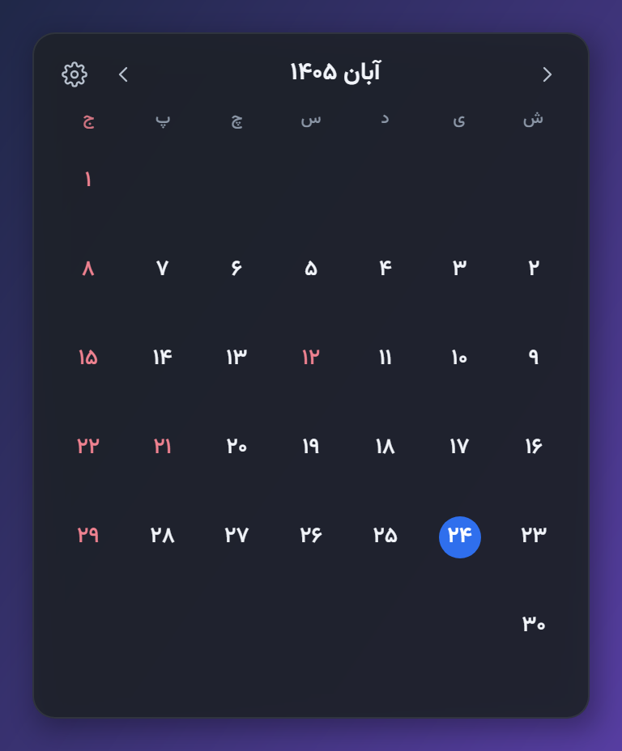
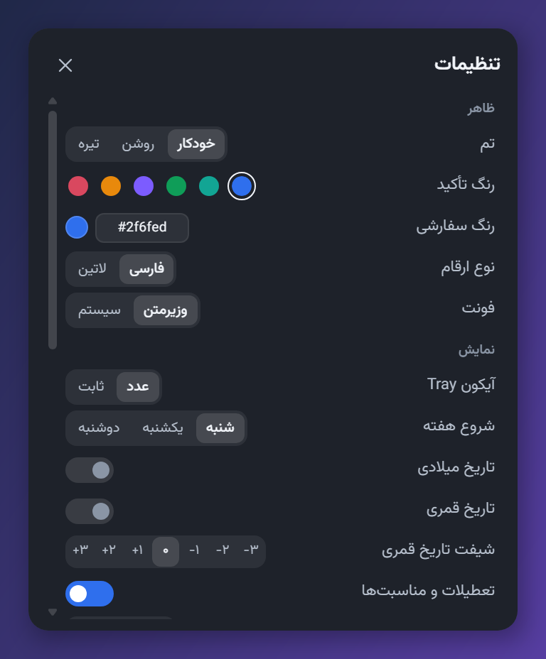
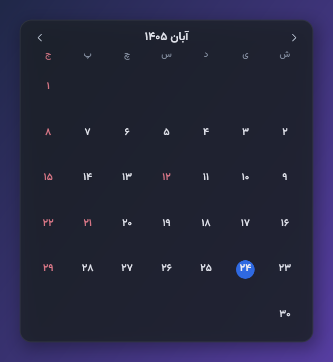
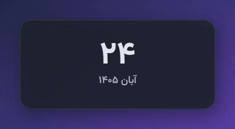

<p align="center"></p>

# PersianCalendar — تقویم شمسی/قمری/میلادی مینیمال برای ویندوز

تقویم شمسی/قمری/میلادی سبک و مینیمال برای **Windows 10/11** که در **System Tray** یا به شکل ویجت دسکتاپ نمایش داده می شود.

آیکون System Tray عدد روز شمسی را نشان می‌دهد و با یک کلیک، پاپ‌آپ تقویم به سبک فلای‌اوت ویندوز ۱۱ باز می‌شود.

ساخته‌شده با **Tauri v2**، **Vite** و **Vanilla TypeScript**؛ بدون Electron و بدون فریم‌ورک سنگین.

تمام هسته‌ی تقویم محلی است و تنها یک بار اتصال اینترنت را برای دریافت مناسبت‌ها نیاز دارد — بدون تله متری و جمع آوری اطلاعات.

> نسخه‌ی فعلی: **۱.۰.۰** · فقط ویندوز · مجوز MIT

## نماها

| پاپ‌آپ تقویم | پنل تنظیمات (درون پاپ‌آپ) |
|---|---|
|  |  |

| ویجت دسکتاپ — کامل | ویجت دسکتاپ — کوچک |
|---|---|
|  |  |

## ویژگی‌ها

- **آیکون پویا در System Tray** — عدد روز شمسی روی آیکون رندر می‌شود و در نیمه‌شب، بعد از بیدار شدن سیستم از Sleep و هنگام تغییر تاریخ/ساعت/منطقه‌ی زمانی به‌روز می‌شود.
- **پاپ‌آپ سریع و مینیمال** — فلای‌اوت ۳۴۴×۴۲۴ بدون نوار عنوان با پس‌زمینه‌ی Mica؛
- **تقویم راست‌به‌چپ** — شبکه‌ی ماه شمسی، امروز با دایره‌ی رنگ تأکید و جمعه‌ها/تعطیلات با رنگ ملایم قرمز. عدد میلادی بالای عدد شمسی و عدد قمری زیر آن نمایش داده می‌شود 
- **منوی راست‌کلیک tray** — امروز، کپی تاریخ امروز (سه قالب راست‌به‌چپ)، حالت ویجت دسکتاپ، تنظیمات، اجرا همراه ویندوز و خروج.
- **تعامل کامل با ماوس و کیبورد** — اسکرول برای ماه قبل/بعد، کلیدهای جهت‌دار برای جابه‌جایی روز، دابل‌کلیک برای کپی تاریخ و منوی راست‌کلیک روی هر روز.
- **مناسبت‌ها و تعطیلات رسمی** — دریافت ماهانه از API، کش محلی روی دیسک، نمایش آفلاین از آخرین داده‌های ذخیره‌شده و تلاش مجدد با فاصله‌ی منطقی.
- **ویجت دسکتاپ اختیاری** — اندازه‌ی کوچک (۲۰۰×۹۲) یا کامل (۳۰۰×۳۳۰)، شفافیت قابل تنظیم، قابل جابه‌جایی و قفل موقعیت؛ (پیش‌فرض خاموش).
- **تنظیمات درون‌پاپ‌آپ با ذخیره‌ی خودکار** — تم، رنگ تأکید، ارقام، فونت، شروع هفته، تاریخ میلادی/قمری، شیفت تاریخ قمری (‎−۳ تا ‎+۳)، شماره‌ی هفته و…
- **Single Instance، کم‌مصرف** — اجرای دوباره فقط پاپ‌آپ نمونه‌ی در حال اجرا را نشان می‌دهد؛ بدون درخواست شبکه‌ی غیرضروری یا تله متری.

## نصب

1. نصب‌کننده‌ی **NSIS** را دانلود و اجرا کنید
   (`PersianCalendar_1.0.0_x64-setup.exe`).
2. نصب برای **کاربر جاری** انجام می‌شود و به دسترسی Administrator نیاز ندارد.
3. برنامه را اجرا کنید؛ آیکون آن در ناحیه‌ی System Tray  ظاهر می‌شود.

> برنامه به‌صورت پرتابل هم اجرا می‌شود: `persian-calendar.exe` 

> **پیش‌نیاز:** WebView2 Runtime. روی ویندوز ۱۱ از پیش نصب است؛ در ویندوز ۱۰ در صورت نبود، نصب‌کننده آن را دانلود می‌کند (نیاز به اینترنت در زمان نصب).

### پین کردن آیکون در ویندوز ۱۱

آیکون‌های System Tray در ویندوز ۱۱ به‌صورت پیش‌فرض داخل **overflow** (فلش `^` کنار ساعت) پنهان می‌شوند. برای اینکه آیکون تقویم همیشه دیده شود:

- روی فلش `^` کنار ساعت کلیک کنید، آیکون **PersianCalendar** را پیدا کنید و آن را با ماوس به نوار وظیفه بکشید؛
  یا به **Settings → Personalization → Taskbar → Other system tray icons** بروید (در بیلدهای قدیمی‌تر ویندوز ۱۱: **System tray icons**) و کلید PersianCalendar را
  روشن کنید.

> **نکته:** آیکون پیش‌فرض PersianCalendar خودِ **عدد روز شمسی** است؛ برای پیدا کردن آن دنبال لوگوی برنامه نگردید، عددی مثل «۲۴» را ببینید.

## استفاده

| تعامل | نتیجه |
|--:|--:|
| **کلیک چپ روی آیکون tray** | باز/بسته شدن پاپ‌آپ (بالای آیکون، ۸ پیکسل بالاتر از تسک‌بار) |
| **کلیک راست روی آیکون tray** | منوی برنامه (امروز، کپی تاریخ امروز، ویجت، تنظیمات، اجرا همراه ویندوز، خروج) |
| **هاور روی آیکون tray** | Tooltip: «یکشنبه ۲۴ آبان ۱۴۰۵»؛ خط دوم مناسبت یا «تعطیل رسمی» (اگر نمایش مناسبت‌ها روشن باشد)؛ خط سوم `2026-11-15 \| میلادی` (اگر تاریخ میلادی روشن باشد) |
| **کلیک روی عنوان ماه** | بازگشت به ماه جاری |
| **دکمه‌های ماه قبل/بعد یا اسکرول ماوس** | ماه قبلی/بعدی |
| **کلیک چپ روی یک روز** | انتخاب روز (و نمایش مناسبت‌هایش در یک خط فوتر) |
| **دابل‌کلیک روی یک روز** | کپی تاریخ با قالب پیش‌فرض و نمایش کوتاه «کپی شد» |
| **کلیک راست روی یک روز** | منوی کوچک: کپی تاریخ شمسی، کپی تاریخ میلادی، رفتن به امروز |
| **هاور روی یک روز** | Tooltip: تاریخ کامل شمسی، تاریخ میلادی/قمری (در صورت روشن بودن) و مناسبت‌های روز |
| **کلیدهای ← → ↑ ↓** | ← روز بعد، → روز قبل، ↑ هفته‌ی قبل، ↓ هفته‌ی بعد (در مرز ماه، ماه عوض می‌شود) |
| **Esc** | بستن منو/تنظیمات؛ در حالت عادی بستن پاپ‌آپ |
| **کلیک بیرون از پاپ‌آپ** | بستن پاپ‌آپ (قابل غیرفعال‌سازی در تنظیمات) |
| **آیکون چرخ‌دنده در هدر** | باز شدن پنل تنظیمات داخل همان پاپ‌آپ |

جزئیات بیشتر در [راهنمای استفاده](docs/USAGE.md).

## تنظیمات

پنل تنظیمات داخل پاپ‌آپ باز می‌شود (نه پنجره‌ی جدا) و در سه گروه **ظاهر**، **نمایش** و **رفتار** مرتب شده است. هر تغییر **خودکار ذخیره می‌شود** (نشانگر «ذخیره شد») و بلافاصله اعمال می‌گردد. فایل تنظیمات:
`%APPDATA%\ir.saeed.persiancalendar\settings.json`.

### ظاهر

| گزینه | توصیف | پیش‌فرض |
|--:|--:|--:|
| تم | خودکار (هماهنگ با ویندوز) / روشن / تیره | خودکار |
| رنگ تأکید | ۶ رنگ آماده: آبی، سبزآبی، سبز، بنفش، نارنجی، قرمز | آبی `2f6fed` |
| رنگ سفارشی | کد رنگ HEX دلخواه (مثل `2f6fed`) | همان آبی |
| نوع ارقام | فارسی / لاتین | فارسی |
| فونت | وزیرمتن / سیستم | وزیرمتن |


## ویجت دسکتاپ

ویجت یک نسخه‌ی ساده از تقویم است که روی دسکتاپ و **زیر همه‌ی پنجره‌ها** نمایش داده می‌شود و در تسک‌بار نمی‌آید.

- روشن/خاموش کردن: از منوی راست‌کلیک tray (**حالت ویجت دسکتاپ**) یا تنظیمات.
- حالت **کوچک** فقط عدد روز و «ماه و سال» را نشان می‌دهد؛ حالت **کامل** شبکه‌ی ماه با دکمه‌های ماه قبل/بعد و اسکرول است.
- با خاموش بودن **قفل موقعیت**، ویجت را با ماوس بکشید؛ موقعیت آن ذخیره و بعد از ری‌استارت بازیابی می‌شود. پیش‌فرض: گوشه‌ی پایین-چپ مانیتور اصلی.
- ویجت گوشه‌های گرد دارد و چون پنجره‌ی شفاف آن دقیقاً به اندازه‌ی خود ویجت است، هیچ لبه‌ی تیز یا سایه‌ی مستطیلی پشت گوشه‌ها دیده نمی‌شود.
- **کلیک راست روی ویجت:** «نمایش کوچک» یا «نمایش کامل» (بسته به اندازه‌ی فعلی)، «قفل موقعیت» (تیک)، «تنظیمات» و «پنهان». «پنهان» ویجت را خاموش می‌کند؛ برای نمایش دوباره از منوی tray یا تنظیمات روشنش کنید.

## مناسبت‌ها، کش و رفتار آفلاین

- هسته‌ی تقویم (شبکه‌ی روزها، عدد روز، آیکون Tray، رنگ جمعه‌ها) کاملاً **محلی** است و به اینترنت نیاز ندارد.
- مناسبت‌ها، تعطیلات رسمی و تاریخ قمری از سرویس`https://pnldev.com/api/calender` دریافت می‌شوند؛ درخواست‌ها از سمت Rust و
  **ماهانه** هستند (`?year=1405&month=8`) و فقط `year` و `month` ارسال می‌شود. هیچ کلید، شناسه یا داده‌ی کاربری فرستاده نمی‌شود.
- پاسخ‌ها در `%LOCALAPPDATA%\ir.saeed.persiancalendar\events\<year>-<month>.json` ذخیره می‌شوند: ماه‌های گذشته دائمی، ماه جاری و آینده با انقضای ۷ روز. فایل کش یک `version` دارد؛ اگر نسخه‌ی کش قدیمی باشد (مثلاً مناسبت‌های بدون تاریخ قمری)، یک‌بار نادیده گرفته و دوباره دریافت می‌شود.
- مناسبت‌های قمری از مناسبت‌های شمسی/میلادی **تفکیک** می‌شوند: سرویس، تاریخ قمری هر مناسبت را داخل کروشه می‌آورد (مثل `[ ٢١ رمضان ]` یا
  `[ ٣ جمادي الثانيه ]`). با روشن بودن **شیفت تاریخ قمری**، این مناسبت‌ها و تعطیلات قمری به همان اندازه جابه‌جا می‌شوند، ولی مناسبت‌های شمسی/میلادی سر
  جای خود می‌مانند.
- الگوی **stale-while-revalidate**: کش موجود (حتی منقضی) فوراً نمایش داده می‌شود و تازه‌سازی در پس‌زمینه انجام می‌گیرد. پس از موفقیت، ماه‌های مجاور
  (±۱) از قبل دریافت می‌شوند. ماه جاری حداکثر یک بار در روز تازه می‌شود.
- **آفلاین:** تقویم و آیکون عادی کار می‌کنند. اگر کشی وجود نداشته باشد، فقط یک خط کم‌رنگ در فوتر پاپ‌آپ نمایش داده می‌شود: «برای نمایش مناسبت‌ها به
  اینترنت متصل شوید». هیچ بنر یا پنجره‌ی خطایی نمایش داده نمی‌شود و شبکه‌ی روزها مسدود نمی‌گردد.
- تلاش مجدد با فاصله‌ی ۵ دقیقه و سپس دو برابر تا سقف ۳۰ دقیقه انجام می‌شود؛ هیچ حلقه‌ی بی‌وقفه‌ای وجود ندارد. با برگشتن اینترنت نیز داده‌ها دوباره
  درخواست می‌شوند.

## عیب‌یابی

**آیکون برنامه در System Tray پیدا نمی‌شود**

- آیکون ممکن است داخل overflow باشد؛ روی فلش `^` کنار ساعت کلیک کنید و آیکون را به نوار وظیفه بکشید (بخش [پین کردن آیکون](#پین-کردن-آیکون-در-ویندوز-۱۱)).
- آیکون عدد روز است، نه لوگو؛ دنبال عددی مثل «۲۴» بگردید.
- از منوی Start برنامه را دوباره اجرا کنید؛ اگر نسخه‌ی قبلی در حال اجراست، پاپ‌آپ نمایش داده می‌شود.

**مناسبت‌ها نمایش داده نمی‌شوند**

- اتصال اینترنت را بررسی کنید. بدون اینترنت تقویم کار می‌کند اما مناسبت‌های جدید دریافت نمی‌شوند.
- اگر فایروال، VPN یا پروکسی اتصال برنامه را محدود می‌کند، دسترسی خروجی برنامه به `pnldev.com` را مجاز کنید.
- در تنظیمات، **پاک کردن کش مناسبت‌ها** را بزنید و بعد پاپ‌آپ را ببندید و دوباره باز کنید.
- سرویس مناسبت‌ها شخصی است و ممکن است موقتاً از کار بیفتد؛ در این حالت تقویم همچنان کار می‌کند.

**ویجت دسکتاپ دیده نمی‌شود**

- مطمئن شوید **حالت ویجت دسکتاپ** از منوی tray یا تنظیمات روشن است (اگر در منوی سریع ویجت «پنهان» را زده‌اید، خاموش شده است).
- ویجت عمداً **زیر همه‌ی پنجره‌ها** قرار می‌گیرد؛ پنجره‌ها را minimize کنید یا کلیدهای `Win + D` را بزنید تا دسکتاپ را ببینید.
- اگر موقعیت ویجت روی مانیتور دیگری ذخیره شده است، **قفل موقعیت** را خاموش کنید و آن را به مانیتور جاری بکشید.
- با **بازنشانی به پیش‌فرض** موقعیت ذخیره‌شده پاک می‌شود و ویجت به گوشه‌ی پیش‌فرض برمی‌گردد.

**چند مانیتور / مقیاس نمایش (DPI) متفاوت**

- پاپ‌آپ همیشه روی مانیتور آیکون و **وسط آن** باز می‌شود؛ برای تسک‌بار بالا، پایین، چپ یا راست هم جای‌گذاری درست است و همیشه داخل ناحیه‌ی کاری مانیتور
  باقی می‌ماند.
- ویجت به‌صورت پیش‌فرض در گوشه‌ی پایین-چپ مانیتور اصلی قرار می‌گیرد. اگر موقعیت آن با تغییر مقیاس نمایش یا قطع/وصل مانیتور جابه‌جا شد، قفل موقعیت را
  موقتاً خاموش کنید و دوباره جای آن را تنظیم کنید.

**ویندوز هنگام نصب هشدار SmartScreen می‌دهد**

- اگر به منبع فایل اطمینان دارید، از **More info → Run anyway** استفاده کنید.

## ساخت از سورس

### پیش‌نیازها

- **Windows 10/11 (64-bit)**
- **Rust** (stable) با target پیش‌فرض `x86_64-pc-windows-msvc`
  (حداقل نسخه‌ی اعلام‌شده در `Cargo.toml`: 1.77)
- **Visual Studio Build Tools** با workload **Desktop development with C++**
  (شامل MSVC و Windows SDK)
- **Node.js 20.19 یا جدیدتر** (به‌دلیل Vite 8) و npm
- **WebView2 Runtime** (روی ویندوز ۱۱ از پیش نصب است)

> **آینه‌ی Cargo (فقط محلی):** اگر `crates.io` روی شبکه‌ی شما در دسترس نیست، می‌توانید یک `.cargo/config.toml` محلی بسازید
> (آینه‌ی Nanjing University)؛ این فایل در مخزن Git نیست. اگر شبکه‌تان دسترسی مستقیم دارد، نیازی به آن نیست.
> برای افزودن وابستگی جدید در حالت آفلاین، ابتدا `offline = true` را از آن فایل بردارید.

### دستورهای ساخت

```powershell
# نصب وابستگی‌های فرانت‌اند
npm install

# اجرا در حالت توسعه (Vite + Tauri)
npm run tauri dev

# ساخت نسخه‌ی نهایی و نصب‌کننده‌ی NSIS
npm run tauri build
```

خروجی‌ها:

```
src-tauri/target/release/persian-calendar.exe                              # اجرای پرتابل
src-tauri/target/release/bundle/nsis/PersianCalendar_1.0.0_x64-setup.exe   # نصب‌کننده
```

> **شبکه‌های محدود:** اگر دانلود ابزارهای NSIS/WiX از GitHub در زمان ساخت ناموفق بود، می‌توانید آینه‌ی محلی ابزارها را اجرا کنید
> (`node scripts/local-tool-mirror.mjs --root <پوشه‌ی ابزارها> --port 8765`)
> و متغیر محیطی `TAURI_BUNDLER_TOOLS_GITHUB_MIRROR=http://127.0.0.1:8765` را تنظیم کنید.
> این کار فقط روی شبکه‌های محدود لازم است.

اسکریپت‌های موجود در `package.json`: `dev` (Vite)، `build` (بررسی TypeScript و ساخت فرانت)، `preview`، `test` (Vitest) و `tauri` (ابزار خط فرمان Tauri).

### ساختار پروژه

```
PersianCalendar/
├─ index.html               # ورودی پاپ‌آپ
├─ widget.html              # ورودی ویجت دسکتاپ
├─ src/                     # فرانت‌اند Vanilla TypeScript
│  ├─ main.ts / widget-main.ts   # ورودی دو پنجره
│  ├─ bootstrap.ts          # راه‌اندازی مشترک (bridge، تنظیمات، مناسبت‌ها)
│  ├─ bridge.ts             # پوشش تایپ‌دار IPC و رویدادها
│  ├─ calendar.ts           # محاسبات تقویم شمسی (jalaali-js)
│  ├─ events.ts             # کش درون‌حافظه‌ای مناسبت‌ها + قواعد نمایش
│  ├─ settings.ts           # وضعیت تنظیمات، ذخیره‌ی خودکار، اعمال ظاهر
│  ├─ types.ts              # تایپ‌های قرارداد IPC
│  ├─ dev/bridge-mock.ts    # mock برای اجرا در مرورگر
│  ├─ ui/                   # popup.ts، settings-panel.ts، widget.ts، dom.ts
│  ├─ styles/               # base، calendar، popup، settings، widget
│  └─ assets/fonts/         # Vazirmatn (woff2 + متن OFL)
├─ src-tauri/               # بخش Rust / Tauri
│  ├─ src/                  # main، commands، settings، jalaali، today، theme،
│  │                        # icon، tray، scheduler، windows، events_api
│  ├─ assets/               # فونت‌های TTF برای رندر آیکون
│  ├─ capabilities/         # مجوزهای پنجره‌ها
│  ├─ tauri.conf.json       # پیکربندی برنامه و بسته‌بندی
│  └─ Cargo.toml
├─ scripts/                 # make-icon.py، make-screenshots.py،
│                           # local-tool-mirror.mjs و ابزارهای عکس‌برداری CDP
├─ icons/                   # آیکون‌های برنامه
├─ assets/app-icon.png      # آیکون منبع
├─ .cargo/ (محلی)           # آینه‌ی Cargo (در مخزن نیست)
├─ docs/                    # CONTRACT.md، USAGE.md، screenshots/
├─ LICENSE
└─ README.md
```

## لایسنس و اعتبارها

- کد پروژه تحت مجوز **MIT** منتشر می‌شود؛ متن کامل در [LICENSE](LICENSE).
- **فونت Vazirmatn** اثر صابر راستی‌کردار، تحت مجوز **SIL OFL 1.1**
  (متن مجوز: `src/assets/fonts/OFL.txt`).
- **jalaali-js** تحت مجوز **MIT** برای تبدیل تاریخ شمسی/میلادی.
- داده‌های مناسبت‌ها از API سرویس **pnldev.com** دریافت می‌شود و متعلق به همان سرویس است.
- ساخته‌شده با **Tauri v2**، **Vite** و **TypeScript**.

