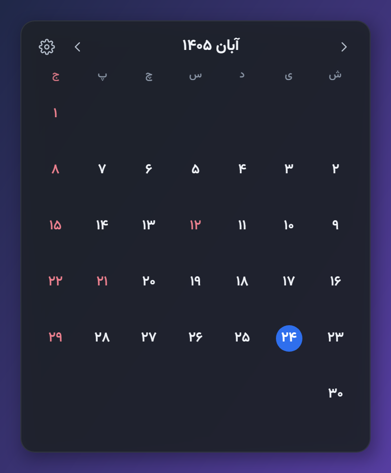
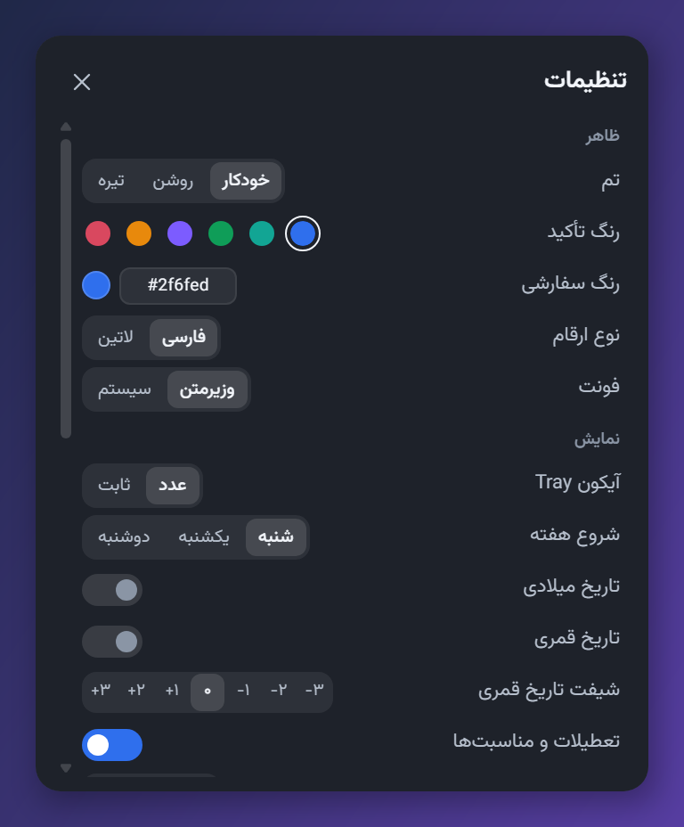
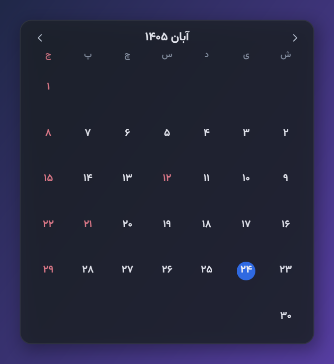

# راهنمای استفاده از PersianCalendar

این راهنما برای کاربر نهایی نوشته شده است: از نصب و اولین اجرا تا استفاده‌ی
روزمره، تنظیمات، ویجت دسکتاپ و پاسخ پرسش‌های رایج.

---

## ۱. نصب و اولین اجرا

1. فایل نصب NSIS (`PersianCalendar_1.0.0_x64-setup.exe`) را اجرا کنید. نصب برای
   کاربر جاری انجام می‌شود و به دسترسی Administrator نیاز ندارد.
2. پس از پایان نصب، برنامه را اجرا کنید. آیکون آن در ناحیه‌ی **System Tray**
   (کنار ساعت) ظاهر می‌شود و **عدد روز شمسی امروز** را نشان می‌دهد.
3. روی آیکون **کلیک چپ** کنید تا پاپ‌آپ تقویم ۳۴۴×۴۲۴ باز شود؛ کلیک چپ
   دوباره یا `Esc` آن را می‌بندد. پاپ‌آپ وسط آیکون و ۸ پیکسل بالاتر از
   تسک‌بار باز می‌شود.

> **اگر آیکون را نمی‌بینید:** در ویندوز ۱۱ آیکون‌های System Tray معمولاً داخل
> overflow (فلش `^` کنار ساعت) پنهان هستند. روی فلش کلیک کنید، آیکون PersianCalendar
> را پیدا و با ماوس به نوار وظیفه بکشید. از مسیر
> **Settings → Personalization → Taskbar → Other system tray icons** هم
> می‌توانید آن را روشن کنید. به‌یاد داشته باشید که آیکون خودِ **عدد روز** است،
> نه لوگوی برنامه.

اولین اجرا نیازی به اینترنت ندارد؛ فقط برای دریافت مناسبت‌ها و تعطیلات رسمی
به اینترنت نیاز است (بخش «مناسبت‌ها و رفتار آفلاین»).

---

## ۲. استفاده‌ی روزمره

### باز و بسته کردن تقویم

- **کلیک چپ روی آیکون tray:** باز/بسته شدن پاپ‌آپ.
- **کلیک بیرون از پاپ‌آپ:** بستن آن (در تنظیمات قابل غیرفعال‌سازی است).
- **Esc:** بستن پاپ‌آپ.

### نگاه سریع بدون باز کردن تقویم

با نگه داشتن ماوس روی آیکون tray، یک tooltip نمایش داده می‌شود:

- خط اول: تاریخ کامل شمسی با نام روز، مثل «یکشنبه ۲۴ آبان ۱۴۰۵».
- خط دوم: مناسبت امروز، یا اگر تعطیل باشد «تعطیل رسمی» (فقط اگر گزینه‌ی
  **تعطیلات و مناسبت‌ها** روشن باشد).
- خط سوم: تاریخ میلادی (مثل `2026-11-15 | میلادی`)، فقط اگر گزینه‌ی
  **تاریخ میلادی** روشن باشد.

### جابه‌جایی بین ماه‌ها

- دکمه‌های کوچک ماه قبل/بعد در هدر پاپ‌آپ.
- **اسکرول ماوس** روی شبکه‌ی روزها.
- **کلیک روی عنوان ماه** برای برگشت به ماه جاری.
- کلیدهای جهت‌دار (بخش «کلیدهای میانبر»).

### کار با روزها

- **عددهای روی روزها:** عدد شمسی وسط خانه است. اگر **تاریخ میلادی** روشن باشد،
  روز میلادی **بالای** عدد شمسی می‌آید و اگر **تاریخ قمری** روشن باشد، روز
  قمری **زیر** عدد شمسی نمایش داده می‌شود. ارقام تاریخ میلادی همیشه لاتین
  (`13`) است؛ تنظیم **نوع ارقام** فقط روی تاریخ شمسی و قمری اثر می‌گذارد.
- **کلیک چپ روی یک روز:** انتخاب روز؛ مناسبت‌های همان روز در یک خط پایین
  پاپ‌آپ (فوتر) نمایش داده می‌شود.
- **هاور روی یک روز:** tooltip کوچک شامل تاریخ کامل شمسی، تاریخ میلادی و
  قمری (در صورت روشن بودن) و مناسبت‌های روز.
- **دابل‌کلیک روی یک روز:** کپی تاریخ آن روز در کلیپ‌بورد با قالب پیش‌فرض
  (پیش‌فرض: `۱۴۰۵/۰۸/۲۴`) و نمایش کوتاه نشانگر «کپی شد».
- **کلیک راست روی یک روز:** منوی کوچک با «کپی تاریخ شمسی»، «کپی تاریخ
  میلادی» و «رفتن به امروز».

### منوی راست‌کلیک آیکون tray

| گزینه | کار |
|---|---|
| **امروز** | پاپ‌آپ را باز می‌کند و به ماه جاری برمی‌گردد |
| **کپی تاریخ امروز** | زیرمنوی سه‌قالبی (راست‌به‌چپ): `۱۴۰۵/۰۸/۲۴`، `۲۴ آبان ۱۴۰۵`، `2026-11-15` |
| **حالت ویجت دسکتاپ** | روشن/خاموش کردن ویجت (تیک‌دار) |
| **تنظیمات** | باز کردن پنل تنظیمات داخل پاپ‌آپ |
| **اجرا همراه ویندوز** | روشن/خاموش کردن اجرای خودکار (تیک‌دار) |
| **خروج** | بستن کامل برنامه |

### بستن کامل برنامه و اجرای خودکار

PersianCalendar نوار عنوان و دکمه‌ی ✕ ندارد؛ برنامه فقط در System Tray زندگی
می‌کند. برای بستن کامل، از منوی راست‌کلیک آیکون، گزینه‌ی **خروج** را بزنید.
اگر «اجرا همراه ویندوز» روشن باشد، برنامه در اجرای بعدی ویندوز دوباره شروع
می‌شود؛ برای جلوگیری دائمی، ابتدا همان گزینه را خاموش کنید. برنامه فقط یک
نمونه اجرا می‌شود: اگر دوباره اجرایش کنید، پاپ‌آپ همان نمونه‌ی در حال اجرا
نمایش داده می‌شود.

---

## ۳. کلیدهای میانبر

پاپ‌آپ باید باز و فعال باشد:

| کلید | عملکرد |
|---|---|
| `←` | روز بعد (چون رابط راست‌به‌چپ است) |
| `→` | روز قبل |
| `↑` | هفته‌ی قبل (۷ روز قبل) |
| `↓` | هفته‌ی بعد (۷ روز بعد) |
| `Esc` | بستن پاپ‌آپ؛ اگر پنل تنظیمات یا منوی روز باز باشد، اول آن‌ها را می‌بندد |

در مرز ماه، جابه‌جایی با کلیدهای جهت‌دار به ماه قبل/بعد منتقل می‌شود. وقتی
فوکوس روی فیلدهای متنی یا انتخابی باشد (مثل فیلد رنگ سفارشی)، کلیدهای
جهت‌دار برای ناوبری روزها استفاده نمی‌شوند. تعامل اصلی با ماوس انجام می‌شود؛
برای کپی سریع از دابل‌کلیک یا منوی راست‌کلیک روی روز استفاده کنید.

در **ویجت دسکتاپ** (حالت کامل): `←` ماه بعد، `→` ماه قبل و `T` بازگشت به
امروز است.

---

## ۴. پنل تنظیمات

آیکون **چرخ‌دنده** در گوشه‌ی هدر پاپ‌آپ را بزنید تا پنل تنظیمات در همان
پاپ‌آپ (نه پنجره‌ی جدا) باز شود. گزینه‌ها در سه گروه **ظاهر**، **نمایش** و
**رفتار** مرتب شده‌اند و **هر تغییر بلافاصله و خودکار ذخیره می‌شود** (نشانگر
«ذخیره شد» در بالای پنل)؛ نیازی به دکمه‌ی ذخیره نیست. تنظیمات پس از ری‌استارت
نیز حفظ می‌شوند و در
`%APPDATA%\ir.saeed.persiancalendar\settings.json` ذخیره می‌گردند.

### ظاهر

- **تم:** خودکار (هماهنگ با تم ویندوز) / روشن / تیره — پیش‌فرض: خودکار.
- **رنگ تأکید:** ۶ رنگ آماده: آبی، سبزآبی، سبز، بنفش، نارنجی، قرمز —
  پیش‌فرض: آبی `#2f6fed`.
- **رنگ سفارشی:** کد رنگ HEX دلخواه (مثل `#2f6fed`).
- **نوع ارقام:** فارسی / لاتین — پیش‌فرض: فارسی.
- **فونت:** وزیرمتن (داخلی) / سیستم — پیش‌فرض: وزیرمتن.

### نمایش

- **آیکون Tray:** عدد روز / آیکون ثابت تقویم — پیش‌فرض: عدد.
- **شروع هفته:** شنبه / یکشنبه / دوشنبه — پیش‌فرض: شنبه.
- **تاریخ میلادی:** نمایش روز میلادی **بالای** عدد روز (همیشه با ارقام لاتین)
  و تاریخ میلادی کامل در tooltip — پیش‌فرض: خاموش.
- **تاریخ قمری:** نمایش روز قمری **زیر** عدد روز و تاریخ قمری کامل در tooltip
  روزها — پیش‌فرض: خاموش.
- **شیفت تاریخ قمری:** از ‎−۳ تا ‎+۳ روز؛ اگر تاریخ قمری برنامه با تقویم
  قمری رسمی یک تا سه روز اختلاف داشت، با این گزینه آن را جابه‌جا کنید
  (عدد مثبت تاریخ قمری را جلوتر می‌برد). مناسبت‌ها و تعطیلات قمری هم به همان
  اندازه جابه‌جا می‌شوند، ولی مناسبت‌های شمسی/میلادی سر جای خود می‌مانند —
  پیش‌فرض: ۰.
- **تعطیلات و مناسبت‌ها:** رنگ‌آمیزی تعطیلات و نمایش مناسبت‌ها — پیش‌فرض:
  روشن.
- **حالت مناسبت‌ها:** «مهم‌ها» (تعطیلات با همه‌ی مناسبت‌ها، بقیه‌ی روزها فقط
  اولین مناسبت) یا «همه» — پیش‌فرض: مهم‌ها.
- **شماره‌ی هفته:** نمایش شماره‌ی هفته در کنار شبکه — پیش‌فرض: خاموش.
- **فرمت کپی تاریخ:** `۱۴۰۵/۰۸/۲۴` / `۲۴ آبان ۱۴۰۵` / `2026-11-15` —
  پیش‌فرض: قالب اسلش. گزینه‌های این فهرست راست‌به‌چپ نمایش داده می‌شوند.

### رفتار

- **اجرا همراه ویندوز:** روشن/خاموش (ثبت در کلید `Run` کاربر جاری).
- **بستن با کلیک بیرون:** پیش‌فرض روشن.
- **ویجت دسکتاپ:** روشن/خاموش.
- **اندازه‌ی ویجت:** کوچک (۲۰۰×۹۲) / کامل (۳۰۰×۳۳۰) — پیش‌فرض: کامل.
- **شفافیت ویجت:** ۳۰٪ تا ۱۰۰٪ — پیش‌فرض: ۹۲٪.
- **قفل موقعیت ویجت:** جلوگیری از جابه‌جایی اتفاقی ویجت — پیش‌فرض: خاموش.
- **پاک کردن کش مناسبت‌ها:** همه‌ی داده‌های ذخیره‌شده‌ی مناسبت‌ها را حذف
  می‌کند؛ در صورت اتصال، داده‌ها دوباره دریافت می‌شوند.
- **بازنشانی به پیش‌فرض:** همه‌ی تنظیمات (از جمله موقعیت ذخیره‌شده‌ی ویجت) را
  به حالت اولیه برمی‌گرداند.

---

## ۵. ویجت دسکتاپ

ویجت یک نسخه‌ی ساده از همان تقویم است که روی دسکتاپ و **زیر همه‌ی
پنجره‌ها** نمایش داده می‌شود و در تسک‌بار نمی‌آید.

**روشن کردن ویجت:** از منوی راست‌کلیک tray گزینه‌ی **حالت ویجت دسکتاپ** را
تیک بزنید، یا در تنظیمات بخش رفتار آن را روشن کنید.

- **اندازه‌ها:** «کوچک» عدد روز و «ماه و سال» را نشان می‌دهد (۲۰۰×۹۲)؛
  «کامل» شبکه‌ی ماه را با دکمه‌های ماه قبل/بعد و اسکرول نمایش می‌دهد
  (۳۰۰×۳۳۰).
- **جابه‌جایی:** اگر **قفل موقعیت** خاموش باشد، ویجت را با ماوس بکشید؛
  موقعیت آن ذخیره می‌شود و بعد از ری‌استارت همان‌جا می‌ماند. پیش‌فرض:
  گوشه‌ی پایین-چپ مانیتور اصلی.
- **شفافیت:** از تنظیمات بین ۳۰٪ و ۱۰۰٪ قابل تنظیم است (پیش‌فرض ۹۲٪).
- **منوی سریع:** روی ویجت کلیک راست کنید تا منوی «نمایش کوچک» یا «نمایش
  کامل» (بسته به اندازه‌ی فعلی)، «قفل موقعیت»، «تنظیمات» و «پنهان» باز شود.
  «تنظیمات» پاپ‌آپ را باز می‌کند و مستقیم پنل تنظیمات را نشان می‌دهد.
  «پنهان» ویجت را خاموش می‌کند؛ برای نمایش دوباره از منوی tray یا تنظیمات
  روشنش کنید.
- **کلیدها (حالت کامل):** `←` ماه بعد، `→` ماه قبل، `T` بازگشت به امروز.
- **گوشه‌ها:** ویجت گوشه‌های گرد دارد و هیچ لبه‌ی تیز یا سایه‌ی مستطیلی
  پشت آن دیده نمی‌شود، چون پنجره‌ی شفاف ویجت دقیقاً به اندازه‌ی خود ویجت است.

---

## ۶. مناسبت‌ها و رفتار آفلاین

- تقویم، آیکون tray و رنگ جمعه‌ها **کاملاً محلی** هستند و همیشه کار می‌کنند.
- مناسبت‌ها، تعطیلات رسمی و تاریخ قمری از API سرویس `pnldev.com` به‌صورت
  ماهانه دریافت و در حافظه‌ی محلی ذخیره می‌شوند
  (`%LOCALAPPDATA%\ir.saeed.persiancalendar\events\<year>-<month>.json`).
- ماه‌های گذشته دائمی ذخیره می‌شوند؛ ماه جاری و آینده پس از ۷ روز منقضی
  محسوب می‌شوند و در پس‌زمینه تازه‌سازی می‌گردند. ماه جاری حداکثر یک بار در
  روز تازه می‌شود و ماه‌های مجاور هم از قبل دریافت می‌شوند.
- اگر به اینترنت متصل نباشید، آخرین داده‌های ذخیره‌شده نمایش داده می‌شوند. اگر
  هیچ داده‌ی ذخیره‌شده‌ای وجود نداشته باشد، فقط یک خط کم‌رنگ در فوتر پاپ‌آپ
  می‌بینید: «برای نمایش مناسبت‌ها به اینترنت متصل شوید». شبکه‌ی روزها همچنان
  کار می‌کند و پنجره یا بنر خطایی نمایش داده نمی‌شود.
- به‌محض برگشتن اینترنت، برنامه دوباره تلاش می‌کند؛ فاصله‌ی بین تلاش‌ها
  پس از خطا از ۵ دقیقه شروع می‌شود و تا ۳۰ دقیقه افزایش می‌یابد.
- برای دریافت دوباره‌ی داده‌ها می‌توانید از تنظیمات، **پاک کردن کش مناسبت‌ها**
  را بزنید و پاپ‌آپ را دوباره باز کنید.

---

## ۷. سوالات متداول (FAQ)

**۱. آیا PersianCalendar به اینترنت نیاز دارد؟**
نه. تقویم، آیکون و ناوبری ماه‌ها آفلاین کار می‌کنند. اینترنت فقط برای دریافت
مناسبت‌ها، تعطیلات رسمی و تاریخ قمری لازم است.

**۲. چرا آیکون برنامه عدد نشان می‌دهد؟**
این یکی از قابلیت‌های اصلی است: آیکون tray به‌صورت پویا عدد روز شمسی امروز را
نمایش می‌دهد و در نیمه‌شب، بعد از بیدار شدن سیستم از Sleep و هنگام تغییر
تاریخ/ساعت/منطقه‌ی زمانی به‌روز می‌شود. از تنظیمات می‌توانید به‌جای آن
«آیکون ثابت» را انتخاب کنید.

**۳. آیا داده‌های من جایی ارسال می‌شود؟**
نه. برنامه هیچ تلمتری ندارد. تنها ارتباط شبکه‌ای، درخواست `GET` برای دریافت
مناسبت‌های ماه است که فقط `year` و `month` را ارسال می‌کند؛ هیچ شناسه، نام یا
داده‌ی کاربری فرستاده نمی‌شود.

**۴. چطور برنامه را ببندم یا از استارتاپ حذف کنم؟**
برنامه دکمه‌ی بستن ندارد؛ از منوی راست‌کلیک آیکون tray گزینه‌ی **خروج** را
بزنید. برای حذف از استارتاپ، گزینه‌ی **اجرا همراه ویندوز** را در همان منو یا
در تنظیمات خاموش کنید.

**۵. مناسبت‌ها دیر می‌آیند یا نمایش داده نمی‌شوند. چه کنم؟**
اتصال اینترنت را بررسی کنید و مطمئن شوید فایروال/VPN/پروکسی اجازه‌ی دسترسی
خروجی برنامه به `pnldev.com` را می‌دهد. سپس در تنظیمات کش مناسبت‌ها را پاک
کنید و پاپ‌آپ را ببندید و دوباره باز کنید. توجه کنید که سرویس مناسبت‌ها شخصی
است و ممکن است موقتاً از کار بیفتد؛ در این حالت تقویم همچنان کار می‌کند.

**۶. آیا می‌توانم تاریخ میلادی یا قمری را ببینم؟**
بله. گزینه‌های **تاریخ میلادی** و **تاریخ قمری** در تنظیمات به‌صورت پیش‌فرض
خاموش‌اند. با روشن کردن آن‌ها، روز میلادی **بالای** عدد شمسی و روز قمری
**زیر** آن نمایش داده می‌شود و تاریخ کامل میلادی/قمری هم در tooltip روزها
می‌آید. ارقام میلادی همیشه لاتین است؛ تنظیم **نوع ارقام** فقط روی شمسی و
قمری اثر می‌گذارد. اگر تاریخ قمری با تقویم رسمی اختلاف داشت، از **شیفت تاریخ
قمری** (‎−۳ تا ‎+۳ روز) استفاده کنید؛ این شیفت روی مناسبت‌ها و تعطیلات قمری هم
اعمال می‌شود.

**۷. ویجت دسکتاپ را نمی‌بینم.**
مطمئن شوید «حالت ویجت دسکتاپ» روشن است (اگر در منوی سریع ویجت «پنهان» را
زده‌اید، خاموش شده است). ویجت عمداً زیر همه‌ی پنجره‌ها قرار می‌گیرد؛
پنجره‌ها را minimize کنید یا `Win + D` را بزنید. اگر روی مانیتور دیگری ذخیره
شده است، قفل موقعیت را خاموش کنید و آن را بکشید؛ یا با **بازنشانی به
پیش‌فرض** موقعیت را پاک کنید.

**۸. آیا روی ویندوز ۱۰ هم کار می‌کند؟**
بله، PersianCalendar برای Windows 10/11 ساخته شده است. فقط مطمئن شوید WebView2
Runtime نصب است (در ویندوز ۱۱ از پیش موجود است؛ نصب‌کننده در ویندوز ۱۰ در
صورت نیاز آن را دانلود می‌کند).

**۹. اگر سرویس مناسبت‌ها از کار بیفتد چه می‌شود؟**
تقویم، آیکون و تعطیلات جمعه همچنان کار می‌کنند و داده‌های ذخیره‌شده‌ی قبلی
نمایش داده می‌شوند. فقط مناسبت‌های جدید دریافت نمی‌شوند؛ پیام خطای دائمی هم
نمایش داده نمی‌شود.
